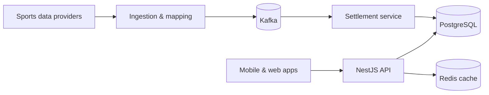
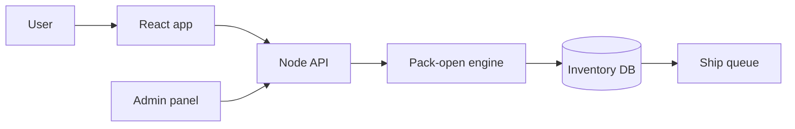
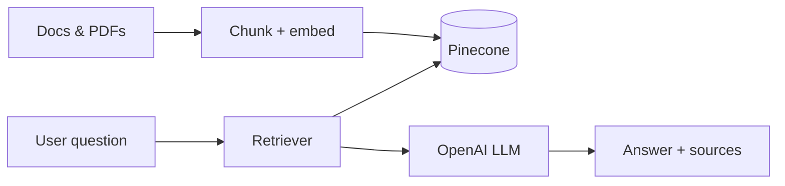
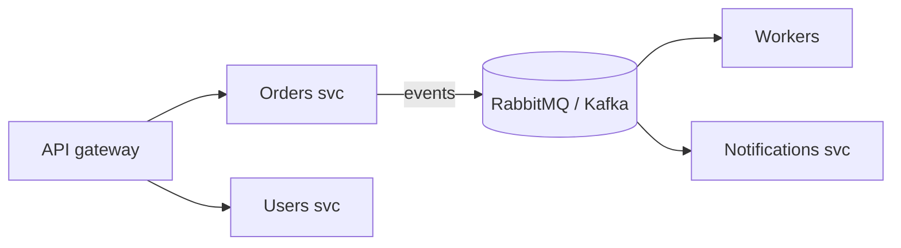
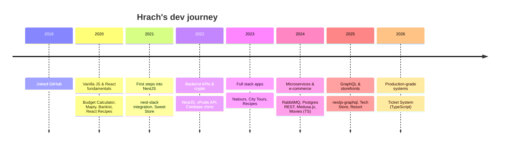

<!-- ============================== HEADER ============================== -->
<p align="center">
  
</p>

<p align="center">
  <a href="https://hrachgalstyan.com">
    
  </a>
</p>

<p align="center">
  <a href="https://hrachgalstyan.com"></a>
  <a href="https://www.linkedin.com/in/hrach-galstyan-a721581b5/"></a>
  <a href="mailto:hrachgalstyann@gmail.com"></a>
  <a href="https://instagram.com/hrachgalstyann"></a>
  <a href="https://www.facebook.com/hrachgalstyann"></a>
</p>

<p align="center">
  
  <a href="https://github.com/hrachgalstyan?tab=followers"></a>
  <a href="https://github.com/hrachgalstyan?tab=repositories"></a>
  
</p>

<p align="center">
  <a href="#-whoami"><kbd>&nbsp;🧑‍💻 whoami&nbsp;</kbd></a>&nbsp;
  <a href="#-tech-stack"><kbd>&nbsp;🧰 stack&nbsp;</kbd></a>&nbsp;
  <a href="#-featured-work"><kbd>&nbsp;🚀 work&nbsp;</kbd></a>&nbsp;
  <a href="#-github-dashboard"><kbd>&nbsp;📊 stats&nbsp;</kbd></a>&nbsp;
  <a href="#-play-tic-tac-toe-with-me"><kbd>&nbsp;🎮 play&nbsp;</kbd></a>&nbsp;
  <a href="#-lets-work-together"><kbd>&nbsp;🤝 hire&nbsp;</kbd></a>
</p>

---

## 🧑‍💻 whoami

<p align="center">
  
</p>

<details>
<summary><b>📜 Prefer code? Click to open <code>hrach.ts</code></b></summary>

```ts
const hrach = {
  role:       "Full Stack Software Engineer",
  location:   "Yerevan, Armenia 🇦🇲",
  experience: "5+ years shipping production web apps",
  backend:    ["Node.js", "NestJS", "Express", "GraphQL", "REST"],
  frontend:   ["React", "TypeScript", "Material UI"],
  data:       ["PostgreSQL", "MySQL", "MongoDB", "Redis", "ElasticSearch"],
  messaging:  ["Kafka", "RabbitMQ"],
  cloud:      ["AWS", "Azure", "GCP", "Docker", "GitHub Actions", "GitLab CI"],
  ai:         ["OpenAI", "LangChain", "Pinecone"],
  askMeAbout: ["NestJS architecture", "microservices", "ORMs", "RAG pipelines"],
};
```

</details>

## 🧰 Tech stack

<sub>Every icon is clickable and links to the tool's home page.</sub>

<p align="center"><sub><b>Languages & frameworks</b></sub><br/>
  <a href="https://www.typescriptlang.org" title="ts"></a>
  <a href="https://developer.mozilla.org/docs/Web/JavaScript" title="js"></a>
  <a href="https://nodejs.org" title="nodejs"></a>
  <a href="https://nestjs.com" title="nestjs"></a>
  <a href="https://expressjs.com" title="express"></a>
  <a href="https://graphql.org" title="graphql"></a>
  <a href="https://react.dev" title="react"></a>
  <a href="https://developer.mozilla.org/docs/Web/HTML" title="html"></a>
  <a href="https://developer.mozilla.org/docs/Web/CSS" title="css"></a>
  <a href="https://sass-lang.com" title="sass"></a>
</p>

<p align="center"><sub><b>Data & messaging</b></sub><br/>
  <a href="https://www.postgresql.org" title="postgres"></a>
  <a href="https://www.mysql.com" title="mysql"></a>
  <a href="https://www.mongodb.com" title="mongodb"></a>
  <a href="https://redis.io" title="redis"></a>
  <a href="https://www.elastic.co" title="elasticsearch"></a>
  <a href="https://www.prisma.io" title="prisma"></a>
  <a href="https://sequelize.org" title="sequelize"></a>
  <a href="https://kafka.apache.org" title="kafka"></a>
  <a href="https://www.rabbitmq.com" title="rabbitmq"></a>
  <a href="https://firebase.google.com" title="firebase"></a>
</p>

<p align="center"><sub><b>Cloud & DevOps</b></sub><br/>
  <a href="https://aws.amazon.com" title="aws"></a>
  <a href="https://azure.microsoft.com" title="azure"></a>
  <a href="https://cloud.google.com" title="gcp"></a>
  <a href="https://www.docker.com" title="docker"></a>
  <a href="https://github.com/features/actions" title="githubactions"></a>
  <a href="https://gitlab.com" title="gitlab"></a>
  <a href="https://www.heroku.com" title="heroku"></a>
  <a href="https://vercel.com" title="vercel"></a>
  <a href="https://www.netlify.com" title="netlify"></a>
  <a href="https://www.linux.org" title="linux"></a>
</p>

<p align="center"><sub><b>UI & tools</b></sub><br/>
  <a href="https://mui.com" title="materialui"></a>
  <a href="https://getbootstrap.com" title="bootstrap"></a>
  <a href="https://git-scm.com" title="git"></a>
  <a href="https://github.com" title="github"></a>
  <a href="https://www.postman.com" title="postman"></a>
  <a href="https://code.visualstudio.com" title="vscode"></a>
  <a href="https://ubuntu.com" title="ubuntu"></a>
</p>

<p align="center">
  
  
  
  
  
  
  
  
</p>

## 🚀 Featured work

Most of my production work lives in **private repositories** under NDA, so client names are left out. **Click any card** to open the case study: the problem, what I built, a live architecture diagram and the impact.

<!--PROJECTS_START-->
<details>
<summary></summary>
<br/>

> **Role:** Backend / Full Stack Engineer &nbsp;·&nbsp; 🔒 Code is private under NDA, [ask me for a walkthrough](mailto:hrachgalstyann@gmail.com?subject=Walkthrough%3A%20Real-time%20Sports%20Pick'em%20Platform)

**🧩 The problem**<br/>
Fans build pick'em entries on live games. Stats arrive from multiple third-party sports data providers with different IDs and formats, and entries must settle correctly and fast once games finish.

**🛠️ What I built**
- Ingestion services that normalize player, team and game data across sports data providers
- Cross-provider team & player mapping so every stat lands on the right entry
- Event-driven settlement pipeline that grades entries as games go final
- Internal admin tooling for ops to monitor and correct data

**🏗️ Architecture** <sub>(drag / zoom the diagram)</sub>



**📈 Impact**
- Reliable, automated settlement instead of manual grading
- Provider-agnostic data layer, so adding a new sport or provider is config, not a rewrite

**Stack:** `NestJS` `TypeScript` `PostgreSQL` `Redis` `Kafka` `AWS`

</details>

<details>
<summary></summary>
<br/>

> **Role:** Full Stack Engineer &nbsp;·&nbsp; 🔒 Code is private under NDA, [ask me for a walkthrough](mailto:hrachgalstyann@gmail.com?subject=Walkthrough%3A%20Collectible%20Card%20Pack%20Platform)

**🧩 The problem**<br/>
Users buy and open packs online, but every card they pull is a real physical item that has to be tracked, valued and eventually shipped.

**🛠️ What I built**
- Pack-opening flow with server-side, auditable outcomes
- Inventory model linking each digital pull to a physical card
- Back-office screens for inventory, packs and ship queues

**🏗️ Architecture** <sub>(drag / zoom the diagram)</sub>



**📈 Impact**
- A fun, instant digital experience on top of a real-world supply chain
- Full audit trail from pack purchase to shipped card

**Stack:** `Node.js` `React` `TypeScript` `PostgreSQL` `AWS` `Docker`

</details>

<details>
<summary></summary>
<br/>

> **Role:** Full Stack / AI Engineer &nbsp;·&nbsp; 🔒 Code is private under NDA, [ask me for a walkthrough](mailto:hrachgalstyann@gmail.com?subject=Walkthrough%3A%20AI%20Knowledge%20Assistant%20(RAG))

**🧩 The problem**<br/>
Teams lose time hunting through docs, wikis and PDFs for answers that already exist somewhere.

**🛠️ What I built**
- Document ingestion & chunking pipeline into a Pinecone vector index
- Retrieval-augmented generation with LangChain + OpenAI, returning cited sources
- Chat UI with streaming answers

**🏗️ Architecture** <sub>(drag / zoom the diagram)</sub>



**📈 Impact**
- Answers in seconds instead of searching manually
- Grounded responses with links back to the original source

**Stack:** `OpenAI` `LangChain` `Pinecone` `NestJS` `React`

</details>

<details>
<summary></summary>
<br/>

> **Role:** Backend Engineer &nbsp;·&nbsp; 🔒 Code is private under NDA, [ask me for a walkthrough](mailto:hrachgalstyann@gmail.com?subject=Walkthrough%3A%20Event-driven%20Microservices%20Backbone)

**🧩 The problem**<br/>
A growing monolith made every release risky and every slow job block user requests.

**🛠️ What I built**
- Service boundaries and message contracts over RabbitMQ / Kafka
- Background workers for heavy jobs with retries and dead-letter queues
- Dockerized services with CI/CD pipelines

**🏗️ Architecture** <sub>(drag / zoom the diagram)</sub>



**📈 Impact**
- Independent deploys per service
- Slow work moved off the request path

**Stack:** `NestJS` `RabbitMQ` `Kafka` `PostgreSQL` `Docker` `GitHub Actions`

</details>

<!--PROJECTS_END-->

<details>
<summary><b>🌍 Open-source & learning projects by year (click to expand)</b></summary>
<br/>

| Year | Projects |
|:---:|---|
| **2026** | [ticket-system](https://github.com/hrachgalstyan/ticket-system) · [baghadratomser.com](https://github.com/hrachgalstyan/baghadratomser.com) · [Cocktails](https://github.com/hrachgalstyan/Cocktails) · [Todo-List](https://github.com/hrachgalstyan/Todo-List) |
| **2025** | [nestjs-graphql](https://github.com/hrachgalstyan/nestjs-graphql) · [Tech-Store](https://github.com/hrachgalstyan/Tech-Store) · [Resort](https://github.com/hrachgalstyan/Resort) |
| **2024** | [medusa.js](https://github.com/hrachgalstyan/medusa.js) · [nestjs_crud](https://github.com/hrachgalstyan/nestjs_crud) · [nest-rabbitMQ-math](https://github.com/hrachgalstyan/nest-rabbitMQ-math) · [postgres-rest](https://github.com/hrachgalstyan/postgres-rest) · [express-sequelize](https://github.com/hrachgalstyan/express-sequelize) · [wedding-invitation](https://github.com/hrachgalstyan/wedding-invitation) · [movies](https://github.com/hrachgalstyan/movies) |
| **2023** | [City-tours](https://github.com/hrachgalstyan/City-tours) · [Hrach-Galstyan](https://github.com/hrachgalstyan/Hrach-Galstyan) · [recipes](https://github.com/hrachgalstyan/recipes) · [natours](https://github.com/hrachgalstyan/natours) |
| **2022** | [nestjs](https://github.com/hrachgalstyan/nestjs) · [coinbase](https://github.com/hrachgalstyan/coinbase) · [vFruits_api](https://github.com/hrachgalstyan/vFruits_api) |
| **2021** | [nest-slack](https://github.com/hrachgalstyan/nest-slack) · [newsflash-app](https://github.com/hrachgalstyan/newsflash-app) · [Sweet-Store](https://github.com/hrachgalstyan/Sweet-Store) |
| **2020** | [mapty](https://github.com/hrachgalstyan/mapty) · [banking_website](https://github.com/hrachgalstyan/banking_website) · [bankist_user](https://github.com/hrachgalstyan/bankist_user) · [cocktail](https://github.com/hrachgalstyan/cocktail) · [printing](https://github.com/hrachgalstyan/printing) · [React-Recipes](https://github.com/hrachgalstyan/React-Recipes) · [github-user](https://github.com/hrachgalstyan/github-user) · [Budget-Calculator](https://github.com/hrachgalstyan/Budget-Calculator) |

</details>

## 📊 GitHub dashboard

<sub>Contribution counts include private repositories.</sub>

<p align="center">
  
  
</p>

<p align="center">
  
</p>

<p align="center">
  <picture>
    <source media="(prefers-color-scheme: dark)" srcset="https://raw.githubusercontent.com/hrachgalstyan/hrachgalstyan/output/github-snake-dark.svg"/>
    <source media="(prefers-color-scheme: light)" srcset="https://raw.githubusercontent.com/hrachgalstyan/hrachgalstyan/output/github-snake.svg"/>
    
  </picture>
</p>

## 🎮 Play Tic-Tac-Toe with me

You're **❌**, my bot is **⭕**. Click an empty square → GitHub opens an issue → hit **Create** → a GitHub Action plays your move and the bot's reply in about 30 seconds. Refresh to see the board update. It plays well but not perfectly, so it can be beaten 😉

<!--TTT_START-->
<div align="center">

**New board**: you're ❌, click any square to start!

<table align="center">
    <tr><td><a href="https://github.com/hrachgalstyan/hrachgalstyan/issues/new?title=ttt%7Cmove%7C1&body=Just%20click%20**Create**%20below%20%F0%9F%91%87.%20Your%20move%20is%20played%20automatically%20in%20about%2030%20seconds%2C%20then%20refresh%20the%20profile."></a></td><td><a href="https://github.com/hrachgalstyan/hrachgalstyan/issues/new?title=ttt%7Cmove%7C2&body=Just%20click%20**Create**%20below%20%F0%9F%91%87.%20Your%20move%20is%20played%20automatically%20in%20about%2030%20seconds%2C%20then%20refresh%20the%20profile."></a></td><td><a href="https://github.com/hrachgalstyan/hrachgalstyan/issues/new?title=ttt%7Cmove%7C3&body=Just%20click%20**Create**%20below%20%F0%9F%91%87.%20Your%20move%20is%20played%20automatically%20in%20about%2030%20seconds%2C%20then%20refresh%20the%20profile."></a></td></tr>
    <tr><td><a href="https://github.com/hrachgalstyan/hrachgalstyan/issues/new?title=ttt%7Cmove%7C4&body=Just%20click%20**Create**%20below%20%F0%9F%91%87.%20Your%20move%20is%20played%20automatically%20in%20about%2030%20seconds%2C%20then%20refresh%20the%20profile."></a></td><td><a href="https://github.com/hrachgalstyan/hrachgalstyan/issues/new?title=ttt%7Cmove%7C5&body=Just%20click%20**Create**%20below%20%F0%9F%91%87.%20Your%20move%20is%20played%20automatically%20in%20about%2030%20seconds%2C%20then%20refresh%20the%20profile."></a></td><td><a href="https://github.com/hrachgalstyan/hrachgalstyan/issues/new?title=ttt%7Cmove%7C6&body=Just%20click%20**Create**%20below%20%F0%9F%91%87.%20Your%20move%20is%20played%20automatically%20in%20about%2030%20seconds%2C%20then%20refresh%20the%20profile."></a></td></tr>
    <tr><td><a href="https://github.com/hrachgalstyan/hrachgalstyan/issues/new?title=ttt%7Cmove%7C7&body=Just%20click%20**Create**%20below%20%F0%9F%91%87.%20Your%20move%20is%20played%20automatically%20in%20about%2030%20seconds%2C%20then%20refresh%20the%20profile."></a></td><td><a href="https://github.com/hrachgalstyan/hrachgalstyan/issues/new?title=ttt%7Cmove%7C8&body=Just%20click%20**Create**%20below%20%F0%9F%91%87.%20Your%20move%20is%20played%20automatically%20in%20about%2030%20seconds%2C%20then%20refresh%20the%20profile."></a></td><td><a href="https://github.com/hrachgalstyan/hrachgalstyan/issues/new?title=ttt%7Cmove%7C9&body=Just%20click%20**Create**%20below%20%F0%9F%91%87.%20Your%20move%20is%20played%20automatically%20in%20about%2030%20seconds%2C%20then%20refresh%20the%20profile."></a></td></tr>
</table>

🧑 Humans **0** &nbsp;·&nbsp; 🤖 Bot **0** &nbsp;·&nbsp; 🤝 Draws **0** &nbsp;·&nbsp; 🎮 Games **0**

<sub>Recent moves: _no moves yet, be the first!_ &nbsp;|&nbsp; <a href="https://github.com/hrachgalstyan/hrachgalstyan/issues/new?title=ttt%7Cnew&body=Just%20click%20**Create**%20below%20%F0%9F%91%87.%20Your%20move%20is%20played%20automatically%20in%20about%2030%20seconds%2C%20then%20refresh%20the%20profile.">🔄 Reset board</a></sub>

</div>
<!--TTT_END-->

## 🛤️ My journey (from my repo history)



## ⚡ Recent GitHub activity

<!--START_SECTION:activity-->
<!--END_SECTION:activity-->

## 🤝 Let's work together

<details open>
<summary><b>💼 What I can help with</b></summary>
<br/>

| | |
|---|---|
| 🧩 **Backend & APIs** | NestJS / Node.js services, GraphQL & REST, clean architecture |
| ⚡ **Real-time & events** | Kafka, RabbitMQ, background workers, live data pipelines |
| 🤖 **AI features** | RAG search, chatbots, LLM integrations with OpenAI + LangChain |
| ☁️ **Cloud & DevOps** | AWS / Azure / GCP, Docker, CI/CD with GitHub Actions & GitLab |

</details>

<p align="center">
  <a href="mailto:hrachgalstyann@gmail.com?subject=Let%27s%20work%20together"></a>
  <a href="https://www.linkedin.com/in/hrach-galstyan-a721581b5/"></a>
  <a href="https://hrachgalstyan.com"></a>
</p>

<p align="center">
  
</p>
